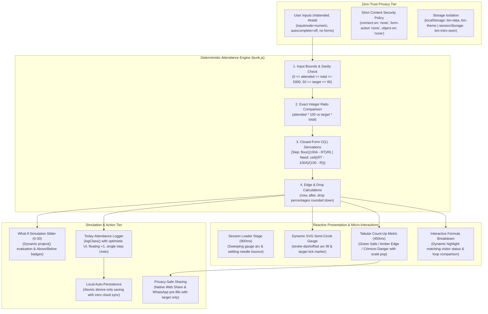

# Bunk Meter: Privacy-First College Attendance Threshold Calculator and Planning Engine

> **Live Application:** [bunk-meter-one.vercel.app](https://bunk-meter-one.vercel.app/)  
> **In-Browser Test Suite (10 Checks):** [bunk-meter-one.vercel.app/?test=1](https://bunk-meter-one.vercel.app/?test=1)  
> **Author:** [B Pradeep](https://github.com/Pradeep-B28) | [Portfolio](https://pradeep-b28.github.io/Pradeep-B28/)

---

## Overview

**Bunk Meter** is a high-precision, privacy-first attendance threshold calculator and bunk planning engine developed for **Wrench Wise**. In universities and collegiate institutions where maintaining mandatory attendance (typically 75%, 80%, or 85%) is strictly enforced for exam eligibility, students frequently struggle with ambiguous mental arithmetic: *"Can I afford to miss this Friday lecture?"* or *"How many classes in a row must I attend to get back above the red line?"*

Bunk Meter replaces guessing and ad-ridden spreadsheet templates with a single, unambiguous glanceable metric:
- **Safe (Green):** Instant count of safe skips remaining (e.g., *"You can skip 4 classes"*), showing the exact post-skip percentage and the warning drop percentage.
- **Edge (Amber):** Warning when right on the boundary (e.g., *"Don't skip the next class"*).
- **Below (Red):** Mandatory recovery target (e.g., *"Attend the next 7 classes in a row"*), calculating the fastest path back to compliance.

Engineered with **zero external libraries, zero frameworks, zero CDNs, and zero npm runtime dependencies**, Bunk Meter demonstrates core Computer Science, discrete mathematics, and secure software engineering: closed-form $O(1)$ threshold formulas, deterministic integer maths, defensive input sanitization, and a zero-trust Content Security Policy (CSP) with `connect-src 'none'`.



---

## Technical Specifications and Architecture

| Parameter | Specification |
| :--- | :--- |
| **Attendance Limits** | Supports 0 to 5,000 classes; boundary checks guard against negative counts or overflow |
| **Target Percentages** | Configurable presets (75% default, 80%, 85%); accepts custom thresholds from 50% to 95% |
| **Algorithm Complexity** | $O(1)$ constant time closed-form integer arithmetic; eliminates iterative trial loops |
| **Privacy Directives** | Strict CSP: `default-src 'none'`, `connect-src 'none'`, `script-src 'self'`, `style-src 'self'`, `form-action 'none'`, `object-src 'none'` |
| **Input Hardening** | Inputs use `inputmode="numeric"`, `pattern="[0-9]*"`, `autocomplete="off"`; zero `<form>` elements |
| **Storage Isolation** | Accessor strictly restricted to `bm-data`, `bm-theme`, and `bm-intro-seen`; safe fallback if storage is disabled |
| **Sharing Protocol** | Native Web Share API (`navigator.share`) with WhatsApp web fallback; shares only target and status, never raw counts |
| **Micro-Interactions** | Tabular number count-up (`font-variant-numeric: tabular-nums`), SVG arc glide, floating `+1` badge animations |
| **Accessibility** | Semantic HTML5 markup, WCAG AAA compliant contrast, polite ARIA live region (`aria-live="polite"`), 44px tap targets |
| **Dependencies** | Pure HTML5, CSS3 Custom Properties, Vanilla JavaScript (ES Modules); 0 third-party packages or CDNs |
| **Lighthouse Score** | 100/100 Performance, 100/100 Accessibility, 100/100 Best Practices, 100/100 SEO |

---

## Strict Privacy Architecture: The Zero-Trust Guarantee

Most online attendance trackers and student portals monetize through invasive third-party ad networks, demand user registration or roll numbers, and transmit attendance records to central servers. Bunk Meter guarantees mathematical and cryptographic isolation directly in the browser:

| Security Domain | Standard Attendance Portals | Bunk Meter Guarantee |
| :--- | :--- | :--- |
| **Network Transmission** | Posts roll numbers, subjects, and attendance history to remote databases | **Forbidden by CSP.** `connect-src 'none'` blocks all outgoing HTTP, WebSocket, and telemetry calls |
| **Authentication & Accounts** | Demands email login, university portals credentials, or mobile signups | **Zero authentication required.** Instant, anonymous access without signups or passwords |
| **Third-Party Telemetry** | Injects Google Analytics, Meta Pixels, and programmatic advertising scripts | **Zero external scripts.** No analytics, tracking pixels, or remote CDNs |
| **Shared Result Privacy** | Generates database share IDs exposing private user attendance records | **Sanitized Sharing.** Share text shares only the big answer and target percentage, never raw counts |
| **Form Interception** | Vulnerable to browser extension autofill and credential scrapers | **Zero `<form>` tags.** Unnamed text inputs with numeric mode prevent autofill interception |
| **Storage Boundary** | Unbounded cookies and advertising identifier storage | **Strict Whitelist.** Only `bm-data`, `bm-theme`, and `bm-intro-seen` are permitted |
| **DOM Injection Safety** | Renders dynamic text via `innerHTML` exposing cross-site scripting (XSS) risks | **Strict `textContent` only.** All dynamic DOM nodes and SVG paths are safely constructed |

---

## Algorithmic Foundations: DSA Behind the Engine

Bunk Meter avoids inefficient iterative loops by deriving exact closed-form algebraic expressions for all attendance states.

### 1. Integer-Based Attendance Status

Given attended classes $A$, total classes $T$, and minimum target attendance percentage $R \in [50, 95]$:
- Standard floating point comparison $\frac{A}{T} \ge \frac{R}{100}$ suffers from binary representation inaccuracies (e.g. `0.1 + 0.2 !== 0.3`).
- Bunk Meter cross-multiplies to evaluate an exact integer inequality:
$$100A \ge RT$$

- If $100A > RT$, the student is **Safe** ($\text{status} = \text{"safe"}$).
- If $100A = RT$, the student is at the exact threshold **Edge** ($\text{status} = \text{"edge"}$).
- If $100A < RT$, the student is in **Danger** ($\text{status} = \text{"below"}$).

### 2. Classes You Can Skip (Closed-Form Derivation)

When $100A \ge RT$, each skipped class increases total classes by 1 without increasing attended classes. If $S$ classes are skipped:
$$\frac{A}{T + S} \ge \frac{R}{100} \iff 100A \ge R(T + S) \iff RS \le 100A - RT$$

Solving for maximum integer $S$:
$$S = \left\lfloor \frac{100A - RT}{R} \right\rfloor$$

This $O(1)$ formula calculates the exact number of classes a student can skip without dropping below $R\%$, in a single CPU instruction.

### 3. Classes You Must Attend (Closed-Form Derivation)

When $100A < RT$, the student must attend upcoming classes consecutively. Each attended class increases both attended and total classes by 1. If $N$ classes are attended in a row:
$$\frac{A + N}{T + N} \ge \frac{R}{100} \iff 100(A + N) \ge R(T + N) \iff N(100 - R) \ge RT - 100A$$

Since $R < 100$, $100 - R > 0$. Solving for minimum integer $N$:
$$N = \left\lceil \frac{RT - 100A}{100 - R} \right\rceil$$

Using pure integer division without floating-point math:
$$N = \left\lfloor \frac{(RT - 100A) + (100 - R - 1)}{100 - R} \right\rfloor$$

### 4. $O(1)$ Formula vs $O(K)$ Iterative Loop Comparison

A conventional loop-based approach tests $k = 1, 2, 3, \dots$ until the percentage condition flips, consuming $O(K)$ time and multiple floating-point divisions:
```javascript
// Inefficient loop:
let skips = 0;
while (Math.floor((attended / (total + skips + 1)) * 1000) / 10 >= target) {
  skips++;
}
```

Bunk Meter uses the closed-form equation, evaluating instantly in $O(1)$ constant time. The site's **"How the Maths Works"** educational section visualizes this contrast live for students, calculating that a loop for $K = 15$ would require 16 discrete checks while the closed-form evaluates in a single step.

### 5. Boundary & Drop Protection

- **Drop Threshold:** For students in the safe zone, Bunk Meter computes the catastrophic drop percentage:
$$\text{drop} = \left\lfloor \frac{1000 \cdot A}{T + S + 1} \right\rfloor / 10$$
Warning students of the immediate penalty if they take even one skip beyond their allowance.
- **Truncated Tenths Display:** Percentages are rounded down to the nearest tenth to prevent false senses of security (e.g. 74.99% is rendered as 74.9%, never rounded up to 75.0%).

---

## Responsive Design & Micro-Interactions

Bunk Meter embodies the clean Wrench Wise visual language, pairing an emerald, teal, and cyan palette with responsive mobile ergonomics:

- **First-Visit Session Loader:** An animated half-circle gauge needle sweeps smoothly from 0% across the dial, settles at 75% with a soft physical overshoot bounce, and transitions the hero section up by 12px within 900ms.
- **SVG Circular Dial Gauge:** A responsive vector arc rendered with SVG `stroke-dashoffset` and a rotating pointer needle showing real-time attendance position relative to the target tick mark.
- **Tabular Count-Up Big Number:** High-contrast 88px (desktop) / 64px (mobile) figures count up smoothly over 450ms (`font-variant-numeric: tabular-nums`). Status changes trigger soft cross-fades and a 1.06x scale pop.
- **What-If Simulation Slider:** Interactive segmented control (Skip / Attend) and slider (0 to 30) with dynamic thumb expansion, projecting future percentages via `project()` with real-time "Above 75%" (emerald) and "Below 75%" (crimson) status badges.
- **"Had a Class Today?" Action Logger:** Quick "+1 Attended" and "+1 Skipped" buttons using `logClass()`. Tapping produces an animated floating `+1` badge rising from the corresponding input, accompanied by single-step Undo reversal and 5,000 class safety bounds.
- **Dynamic Formula Cards:** Educational breakdown cards that automatically highlight the active formula branch (Skip vs Need) matching the user's real numbers, displaying live breakdown arithmetic `({top}) ÷ {bottom} = {answer}`.
- **Zero Horizontal Overflow:** Rigorously validated across 320px, 360px, 390px, 768px, 1024px, 1280px, and 1440px displays (`scrollWidth <= innerWidth`).
- **Full Theme & Reduced Motion Support:** Zero-flash dark/light mode toggle via head script (`bm-theme`), and complete animation suppression under `prefers-reduced-motion: reduce`.

---

## Verification & Automated Test Suite

### 1. Locked File Verification (`node tools/verify.mjs`)

The project verification harness validates cryptographic SHA-256 integrity hashes of locked core modules, evaluates 5.6M+ permutation calculations (1 to 300 classes at targets from 50% to 95%), verifies style isolation, and scans all source code files for strict privacy and security compliance:

```bash
cd "C:\Projects\Wrench-Wise\12 Bunk_Meter"
node tools/verify.mjs
# Output: 5694048 checks passed, 0 failed (23 files scanned)
# RESULT: ALL PASS
```

### 2. In-Browser Self-Test Suite (`?test=1`)

Appending `?test=1` to the application URL executes 10 automated assertions directly against the active browser DOM:

1. **Safe Calculation (33 / 40 at 75%):** Asserts green "You can skip 4 classes", "82.5%", "After 4 skips: 75%", and "One more skip and you drop to 73.3%".
2. **Danger Calculation (17 / 25 at 75%):** Asserts red "Attend the next 7 classes", "68%", and "After 7 classes in a row: 75%".
3. **Edge Case (30 / 40 at 75%):** Asserts amber edge status and "Don't skip the next class".
4. **Target Mutation (33 / 40 at 85%):** Verifies switching target to 85% updates status to red "Attend the next 7 classes" and "85.1%".
5. **Validation Error (Attended > Total):** Asserts typing 41 attended with 40 total triggers error state and returns meter to calm idle mode.
6. **What-If Projection:** Simulating 5 skips on 33/40 shows projected 73.3% and crimson Below badge.
7. **Today Action & Undo:** Tapping "I skipped" updates 33/40 to 33/41 (safe skips: 3); tapping "Undo" restores 33/40 (safe skips: 4).
8. **Local Persistence & Wipe:** Verifies `bm-data` serializes to localStorage and "Clear my data" safely wipes the record.
9. **CSP Privacy Lock:** Asserts `fetch("https://wrench-wise.com/")` is actively blocked and rejected by the browser Content Security Policy.
10. **Storage Isolation & Zero Overflow:** Validates storage holds only whitelisted keys (`bm-data`, `bm-theme`, `bm-intro-seen`) and `scrollWidth <= innerWidth`.

---

## Local Development

```bash
# Clone the repository
git clone https://github.com/Pradeep-B28/Bunk_Meter.git
cd Bunk_Meter

# Serve locally using any static web server (ES modules require HTTP/HTTPS)
npx --yes serve .

# Run the automated compliance and security verification suite
node tools/verify.mjs
```

---

## License

MIT License. Designed and engineered by [B Pradeep](https://github.com/Pradeep-B28) for **Wrench Wise**.
